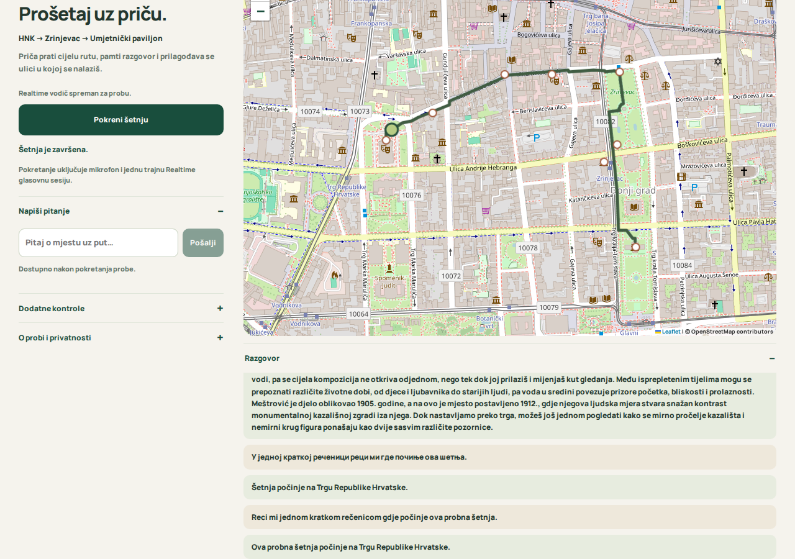

# Moje šetnje — neovisni javni demo

https://moje-setnje-delta.vercel.app/

Planer i GPX rade na Vercelu bez veze prema Bartolu. Build preuzima zamrznute javne podatke i provjerava SHA256. Prethodno izračunate geometrije ubrzavaju prvo učitavanje.

## AI glasovni vodič

https://moje-setnje-delta.vercel.app/voice/

WebRTC signalizacija radi na Vercelu, upravljanje probnom turom u pregledniku. Postojeći OpenAI Realtime razgovor je aktivan. API ključ je Secret samo za Production, nije u repozitoriju. API se naplaćuje zasebno; Hobby hosting ima besplatne kvote.

Provjereno stvarnom glasovnom vezom uz sintetički mikrofon: priča, izgovoreno pitanje, glasovni odgovor, pisano pitanje i zatvaranje veze/mikrofonskog toka. Stvarni korisnikov mikrofon i GPS na terenu nisu testirani. Vodič prati simuliranu HNK–Zrinjevac–Paviljon rutu s osam priča, ne proizvoljnu rutu planera.

Ograničenje pokretanja je po instanci, nije tvrdi globalni limit API potrošnje.

